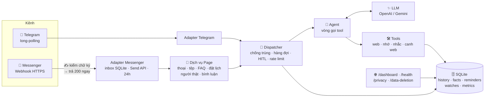
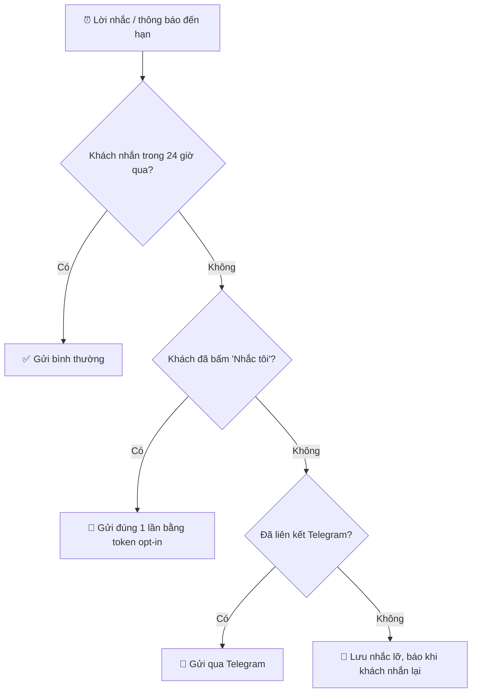

<div align="center">

# 🤖 Bekane Bot

### Trợ lý AI đa kênh: một bộ não, nhiều nơi trò chuyện

**Telegram** · **Facebook Messenger** · *(sắp tới: Zalo, Instagram, Discord, Web chat)*


*Nhìn ảnh · nghe tin thoại · đọc PDF · nhớ lâu · nhắc lịch · canh website · trả lời có dẫn nguồn · chuyển cho người thật*

[🚀 Chạy thử trong 2 phút](#-chạy-thử-trong-2-phút) ·
[📘 Hướng dẫn Messenger](docs/messenger/HUONG-DAN-MESSENGER.md) ·
[🧭 Kiến trúc](#-kiến-trúc) ·
[🛠️ Dashboard](#️-dashboard-admin) ·
[❓ Lỗi thường gặp](docs/messenger/HUONG-DAN-MESSENGER.md#bảng-xử-lý-lỗi-thường-gặp)

</div>

---

## 💬 Bekane trông như thế nào?

```text
👤 Khách:   bao gia goi cham soc da the nao a
🤖 Bekane:  Gói chăm sóc da cơ bản: 350.000đ / buổi, gói 5 buổi: 1.500.000đ.
            📎 Nguồn: Bảng giá 2026
            [ Đặt lịch hẹn ]  [ Gặp nhân viên ]  [ Trợ giúp ]

👤 Khách:   🎤 (tin nhắn thoại 6 giây) "nhắc mình 8 giờ sáng mai gọi lại cho shop"
🤖 Bekane:  ⏰ Đã đặt lời nhắc lúc 08:00 ngày 22/11. Vì đã quá 24 giờ kể từ tin nhắn
            gần nhất của bạn, bấm "Nhắc tôi" để Messenger cho phép mình gửi nhắc nhé.
            [ 🔔 Nhắc tôi ]

👤 Khách:   📄 hop-dong.pdf  "điều khoản huỷ là gì?"
🤖 Bekane:  Theo Điều 7 của tài liệu: huỷ trước 48 giờ được hoàn 100%...
            [ Đóng tài liệu ]  [ Đặt lịch hẹn ]  [ Gặp nhân viên ]
```

> Bot luôn tự giới thiệu là **chatbot AI** ngay câu chào đầu tiên, theo chính sách của Meta.

---

## ✨ Tính năng

<table>
<tr>
<td width="50%" valign="top">

### 🧠 Thông minh
- 🖼️ **Nhìn ảnh**: OCR, đọc ảnh chụp màn hình, đọc code
- 🎤 **Tin nhắn thoại**: chuyển giọng nói thành chữ rồi trả lời
- 📄 **Đọc tệp** PDF / DOCX / TXT, tóm tắt và hỏi đáp trên tệp
- 📚 **Kho kiến thức (RAG)**: trả lời **có dẫn nguồn**, không chắc thì nói *không biết*
- 🌏 **Tự nhận Việt / Anh**, cả khi gõ tiếng Việt không dấu
- 🔎 Tìm web (Tavily + DuckDuckGo), đọc link (chống SSRF)
- 🗂️ **Bộ nhớ dài hạn** theo từng người, đánh dấu tin cũ, tombstone

</td>
<td width="50%" valign="top">

### 💼 Cho Page bán hàng
- 💡 **Quick reply gợi ý** 2–3 bước tiếp theo sau mỗi câu trả lời
- 📅 **Đặt lịch hẹn**: hỏi tên, số điện thoại, thời gian, xác nhận rồi báo admin
- 🙋 **Chuyển người thật** khi khách yêu cầu hoặc bot không chắc, tự bật lại sau N phút
- 💬 **Tự trả lời bình luận** + Private Reply vào Messenger
- ⏰ **Nhắc lịch & canh website** đúng luật cửa sổ 24 giờ
- 🔗 **Liên kết Telegram** để nhận nhắc lỡ và cảnh báo hệ thống
- 🔐 "Xem / Xoá dữ liệu của tôi" ngay trong chat

</td>
</tr>
<tr>
<td valign="top">

### 🛡️ An toàn
- ✍️ Kiểm chữ ký `X-Hub-Signature-256` (timing-safe) trên raw body
- 👮 Admin theo **ID số** (Telegram ID / PSID), không theo tên hiển thị
- ✅ Xác nhận **Đồng ý / Huỷ** trước thao tác nguy hiểm
- 🙈 Che token / API key trong mọi câu trả lời và log
- 🧱 Tài liệu và trang web chỉ là **dữ liệu**, không bao giờ là lệnh (chống prompt injection)

</td>
<td valign="top">

### ⚙️ Vận hành
- 🗄️ **SQLite** qua lớp repository có migration, sẵn sàng đổi sang PostgreSQL
- 🔁 Hàng đợi và lời nhắc **bền vững**, không mất khi khởi động lại
- 🚦 Giới hạn tốc độ theo từng người, chống spam
- 📊 **Dashboard** + thống kê token, chi phí, độ trễ, tool, lỗi
- 🧾 Log JSON (pino), `/health`, kiểm `.env` bằng zod, **báo lỗi tiếng Việt**
- 🐳 Docker + Caddy HTTPS · systemd · GitHub Actions

</td>
</tr>
</table>

### 📋 So sánh theo kênh

| Tính năng |  |  |
|---|:-:|:-:|
| Chat AI, nhìn ảnh, 11 tool | ✅ | ✅ |
| Nhóm, topic, `/mode`, bộ nhớ nhóm | ✅ | ➖ *Page chỉ chat 1-1* |
| Xác nhận thao tác | gõ `ok` / `thôi` | nút **Đồng ý / Huỷ** *(vẫn hiểu khi gõ)* |
| Lệnh | `/slash` | Persistent Menu · Get Started · Ice Breakers · Quick Replies · gõ tay |
| Nhắc lịch, canh website | gửi lúc nào cũng được | cửa sổ 24h → "Nhắc tôi" → nhắc lỡ → Telegram |
| Tin thoại · đọc tệp · kho kiến thức | ➖ | ✅ |
| Đặt lịch · chuyển người thật · trả lời bình luận | ➖ | ✅ |
| Dashboard · thống kê · log | ✅ | ✅ |

---

## 🚀 Chạy thử trong 2 phút

> **Chưa cần Facebook Page, chưa cần token.** Trình giả lập chạy đủ luồng webhook → bot → Send API giả.

```bash
git clone https://github.com/luan0217091310-gif/bot-facebook-message.git bekane
cd bekane
npm ci
npm run messenger:sim -- --mock-ai     # chat thử ngay, AI giả lập
```

Có API key OpenAI/Gemini thì đặt `AI_API_KEY` và chạy `npm run messenger:sim` để bot trả lời thật.

<details>
<summary><b>🎮 Các lệnh trong trình giả lập</b></summary>

| Gõ | Tác dụng |
|---|---|
| *(chữ bình thường)* | nhắn tin như khách |
| `:1` … `:9` | bấm quick reply số N |
| `:postback /help` | bấm nút menu |
| `:comment <nội dung>` | giả lập bình luận bài viết |
| `:file <đường dẫn>` | gửi tệp PDF/DOCX/TXT |
| `:kb <nguồn>\|<nội dung>` | nạp kho kiến thức |
| `:user <psid>` | đổi sang người dùng khác (thử quyền admin) |
| `:advance <giờ>` | tua thời gian (thử luật 24 giờ) |
| `:notify <text>` | thử gửi thông báo chủ động |

</details>

---

## 🧭 Kiến trúc



**Một bộ não, nhiều adapter.** Dispatcher, agent, tools, bộ nhớ, lịch nhắc và persona không biết mình đang chạy trên kênh nào.
Thêm kênh mới chỉ cần viết một `ChannelAdapter` (`src/channel.ts`) và bật trong `ENABLED_CHANNELS`.

<details>
<summary><b>📁 Cấu trúc thư mục</b></summary>

```text
src/
├── index.ts              # khởi động các kênh theo ENABLED_CHANNELS
├── brain.ts              # "bộ não" dùng chung: dispatcher + agent + tools + store
├── channel.ts            # interface ChannelAdapter
├── adapters/
│   ├── telegram/         # long-polling, chia tin 4096 ký tự
│   └── messenger/        # webhook, chữ ký, Send API, chia tin 2000 ký tự, 24h, OTN, profile
├── core/                 # dispatcher, agent, llm, docstore (SQLite), metrics, logger, env, redact…
├── services/             # page, documents (RAG), booking, language, links
├── tools/                # 11 tool của agent
├── web/                  # dashboard, privacy, data deletion
└── simulator.ts          # trình giả lập chat Messenger
config/persona.prompt.md  # tính cách bot, tự nạp lại khi sửa
deploy/                   # Caddyfile, nginx, systemd
docs/messenger/           # hướng dẫn, bản đồ tính năng
```

</details>

---

## 📘 Đưa lên Messenger thật: 7 bước

> Hướng dẫn chi tiết, kèm hình dung từng nút bấm: **[docs/messenger/HUONG-DAN-MESSENGER.md](docs/messenger/HUONG-DAN-MESSENGER.md)**

| # | Việc | Thời gian |
|:-:|---|:-:|
| 1️⃣ | Tạo **Facebook Page** | 5 phút |
| 2️⃣ | Tạo app ở **Meta for Developers**, thêm Messenger, lấy *Page Access Token* + *App Secret* | 10 phút |
| 3️⃣ | `npm run dev` + `cloudflared tunnel --url http://localhost:3000`, khai báo Callback URL `…/webhooks/messenger` | 10 phút |
| 4️⃣ | Thêm tài khoản **tester**, nhắn thử, gõ `/id` để lấy PSID, điền vào `ADMIN_PSIDS` | 5 phút |
| 5️⃣ | `npm run messenger:setup` để cài menu, nút Bắt đầu, lời chào | 1 phút |
| 6️⃣ | Lên VPS: `docker compose up -d --build` (HTTPS tự động bằng Caddy) | 15 phút |
| 7️⃣ | Nộp **App Review** (có sẵn `/privacy` + `/data-deletion`), rồi chuyển **Live** | vài ngày |

### 🔑 Biến môi trường tối thiểu

```ini
ENABLED_CHANNELS=messenger            # hoặc telegram,messenger
AI_API_KEY=sk-...
FB_PAGE_ID=123456789012345
FB_PAGE_ACCESS_TOKEN=EAAG...
FB_APP_SECRET=...
FB_VERIFY_TOKEN=chuoi-bi-mat-tu-dat
PUBLIC_BASE_URL=https://bot.example.com
ADMIN_PSIDS=                          # điền sau khi gõ /id
DASHBOARD_PASSWORD=mat-khau-it-nhat-12-ky-tu
```

Xem đủ biến, kèm chú thích tiếng Việt, trong [`.env.example`](.env.example). Thiếu hoặc sai biến thì bot dừng và in danh sách lỗi bằng tiếng Việt.

---

## ⏰ Luật cửa sổ 24 giờ, xử lý đúng cách

Messenger chỉ cho Page nhắn trong **24 giờ** kể từ tin nhắn gần nhất của khách. Bekane không lách luật:



---

## 🛠️ Dashboard admin

Mở **`https://<tên-miền>/dashboard`** và đăng nhập bằng `DASHBOARD_PASSWORD`.

| 📊 Thống kê | 💬 Hội thoại | 📚 Kho kiến thức |
|---|---|---|
| Tin đến / đi, người dùng hoạt động, độ trễ TB & P95, token, **chi phí ước tính**, tool dùng nhiều, lỗi theo ngày | Đọc hội thoại, **trả lời thay bot**, chuyển người thật, bật/tắt bot từng người, xoá ghi nhớ, huỷ nhắc, bỏ canh web | Dán FAQ / bảng giá / chính sách. Bot trả lời kèm **Nguồn:** |

🔒 Cookie ký HMAC · chống CSRF · khoá IP sau 5 lần sai · tự động sáng/tối theo hệ thống.

---

## 🧰 Lệnh hay dùng

| Lệnh | Ý nghĩa |
|---|---|
| `npm run dev` | chạy bot ở chế độ phát triển |
| `npm run messenger:sim` | 🎮 trình giả lập chat Messenger |
| `npm run messenger:setup` | cài menu, Get Started, lời chào, Ice Breakers |
| `npm run data:migrate` | chuyển dữ liệu JSON cũ sang SQLite *(không xoá file cũ)* |
| `npm run typecheck` · `npm test` · `npm run build` | kiểm tra kiểu · chạy 99 test · build |
| `docker compose up -d --build` | chạy production với HTTPS |

### 💬 Lệnh trong chat

| Ai dùng | Lệnh |
|---|---|
| 👥 Mọi người | `/help` · `/stop` · `/memories` · `/reminders` · `/watches` · `/id` · `/book` · `/faq` · `/human` · `/lang` · `/data` · `/delete` · `/link` |
| 👮 Admin | `/status` · `/pause` · `/resume` · `/clear_history` |

*Trên Messenger, các lệnh chính có sẵn trong menu ☰, và vẫn hiểu khi gõ tay ("trợ giúp", "gặp nhân viên", "xoá dữ liệu của tôi"…).*

---

## 🗺️ Tài liệu

| Tài liệu | Nội dung |
|---|---|
| 📘 [HUONG-DAN-MESSENGER.md](docs/messenger/HUONG-DAN-MESSENGER.md) | Từ tạo Page đến Live, kèm bảng xử lý lỗi |
| 🗺️ [FEATURE-MAP.md](docs/messenger/FEATURE-MAP.md) | Mỗi tính năng Telegram chuyển sang Messenger thế nào |
| 📋 [PLAN.md](PLAN.md) · [PROGRESS.md](PROGRESS.md) | Kế hoạch, tiến độ, **việc bạn cần tự làm** |
| 📝 [CHANGELOG.md](CHANGELOG.md) | Lịch sử thay đổi |
| 📱 [README-TELEGRAM.md](docs/telegram/README-TELEGRAM.md) · [HUONG-DAN-XAY-BOT.md](HUONG-DAN-XAY-BOT.md) | Tài liệu gốc của bản Telegram |

---

<div align="center">

Làm bởi **Phùng Hữu Luân** cùng các trợ lý AI 🤝 · Tuân thủ [Chính sách Messenger Platform](https://developers.facebook.com/docs/messenger-platform/policy)

⭐ *Nếu thấy hữu ích, hãy thả một sao cho repo nhé!*

</div>
